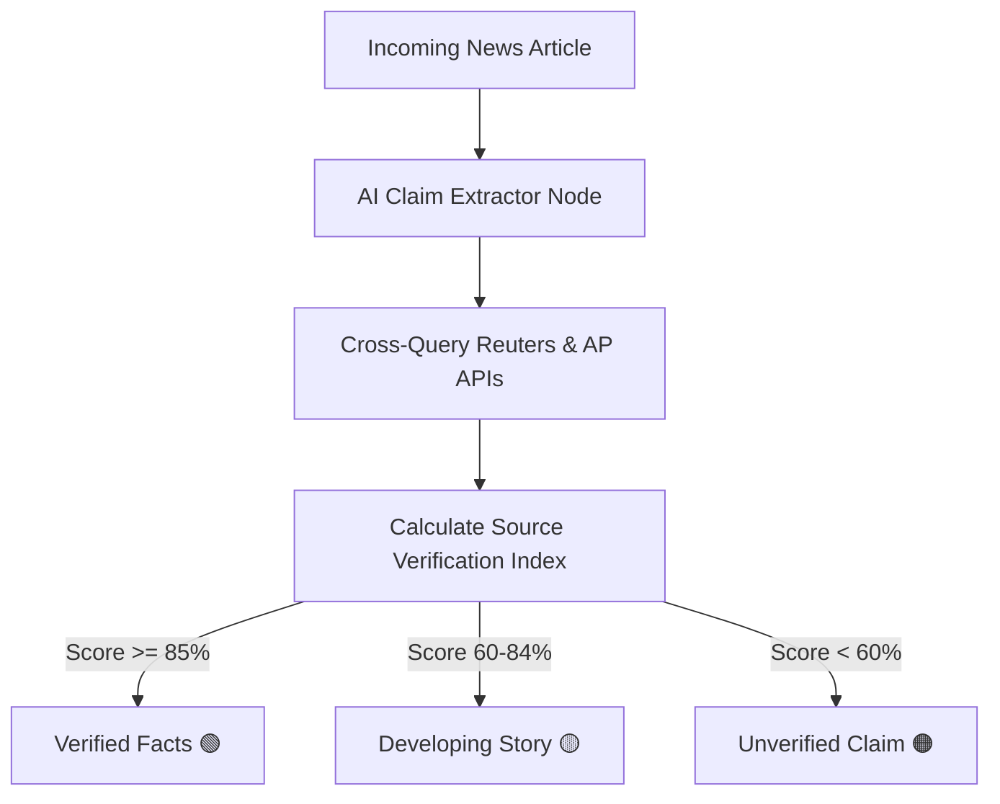

# 04. Interactive Micro-Polls & Real-Time Fact-Checking Engine

This document details the architecture for **Interactive Micro-Polls** and **Real-Time AI Fact-Checking Credibility Badges**.

---

## 1. Interactive Micro-Polls Architecture

### 1.1 Overview
To increase user engagement beyond reading, Tattle embeds 1-tap opinion polls on the back of cards (e.g., *"Will AI replace 30% of software jobs by 2028?"*). Tapping an option immediately reveals live community vote percentages with smooth animations.

---

### 1.2 Poll Schema & Atomic Vote Aggregator (Ktor Server)

```kotlin
package com.example.tattle.polls

import org.jetbrains.exposed.dao.id.IntIdTable
import org.jetbrains.exposed.sql.*
import org.jetbrains.exposed.sql.transactions.transaction
import kotlinx.serialization.Serializable

object ArticlePollsTable : IntIdTable("article_polls") {
    val articleId = varchar("article_id", 100).uniqueIndex()
    val question = varchar("question", 300)
    val optionA = varchar("option_a", 100)
    val optionB = varchar("option_b", 100)
    val votesA = integer("votes_a").default(0)
    val votesB = integer("votes_b").default(0)
}

@Serializable
data class PollVoteRequest(val articleId: String, val selectedOption: String, val userIdentifier: String)

@Serializable
data class PollVoteResponse(val success: Boolean, val votesA: Int, val votesB: Int, val percentageA: Float, val percentageB: Float)
```

#### Ktor Atomic Vote Handler Endpoint:
```kotlin
post("/api/polls/vote") {
    val req = call.receive<PollVoteRequest>()
    val result = transaction {
        val poll = ArticlePollsTable.selectAll().where { ArticlePollsTable.articleId eq req.articleId }.singleOrNull()
            ?: return@transaction null

        if (req.selectedOption == "A") {
            ArticlePollsTable.update({ ArticlePollsTable.articleId eq req.articleId }) {
                with(SqlExpressionBuilder) { it.update(votesA, votesA + 1) }
            }
        } else {
            ArticlePollsTable.update({ ArticlePollsTable.articleId eq req.articleId }) {
                with(SqlExpressionBuilder) { it.update(votesB, votesB + 1) }
            }
        }

        val updated = ArticlePollsTable.selectAll().where { ArticlePollsTable.articleId eq req.articleId }.single()
        val total = (updated[ArticlePollsTable.votesA] + updated[ArticlePollsTable.votesB]).coerceAtLeast(1)
        val pA = (updated[ArticlePollsTable.votesA].toFloat() / total) * 100f
        val pB = (updated[ArticlePollsTable.votesB].toFloat() / total) * 100f

        PollVoteResponse(true, updated[ArticlePollsTable.votesA], updated[ArticlePollsTable.votesB], pA, pB)
    }

    if (result != null) call.respond(result) else call.respond(HttpStatusCode.NotFound)
}
```

---

## 2. Real-Time Fact-Checking & Credibility Badge Engine

### 2.1 Overview
Fake news and clickbait erode reader trust. Tattle cross-verifies factual claims against trusted wire service APIs (**Reuters**, **Associated Press**, **Bloomberg**, **AFP**) and assigns a **Credibility Score Badge** on every card.

---

### 2.2 Fact-Verification Pipeline



---

### 2.3 Credibility Badge Model & UI Renderer

```kotlin
@Serializable
enum class CredibilityLevel(val label: String, val badgeColorHex: Long) {
    VERIFIED("Verified Facts 🟢", 0xFF2E7D32),
    DEVELOPING("Developing Story 🟡", 0xFFF57F17),
    UNVERIFIED("Unverified Source 🟠", 0xFFE65100)
}

@Composable
fun FactCheckBadge(credibility: CredibilityLevel) {
    Surface(
        color = Color(credibility.badgeColorHex).copy(alpha = 0.15f),
        shape = RoundedCornerShape(12.dp),
        border = BorderStroke(1.dp, Color(credibility.badgeColorHex).copy(alpha = 0.4f))
    ) {
        Text(
            text = credibility.label,
            color = Color(credibility.badgeColorHex),
            fontSize = 10.sp,
            fontWeight = FontWeight.Bold,
            modifier = Modifier.padding(horizontal = 8.dp, vertical = 3.dp)
        )
    }
}
```
