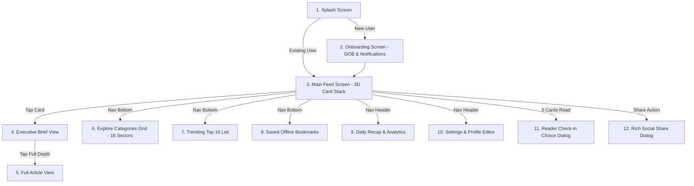
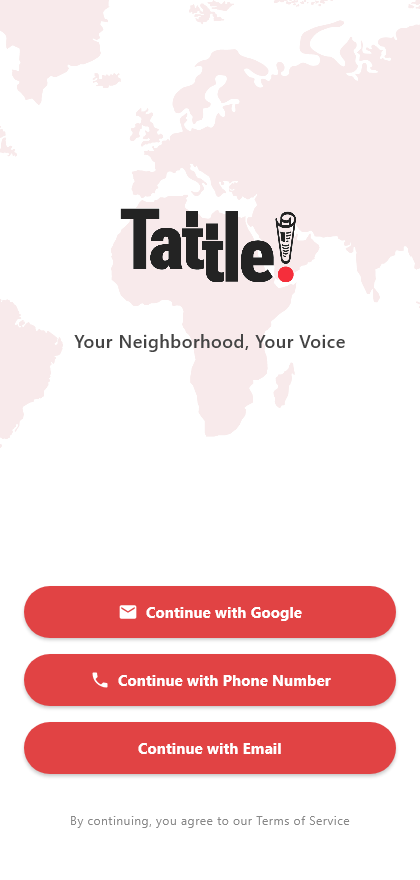
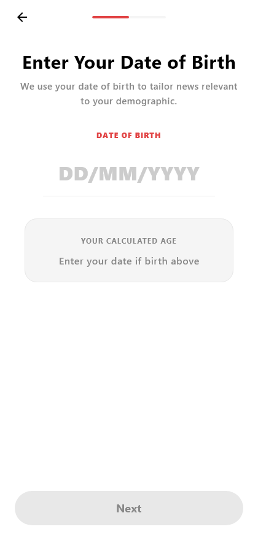
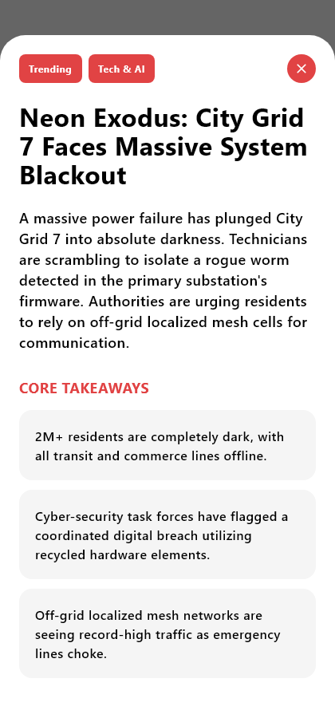
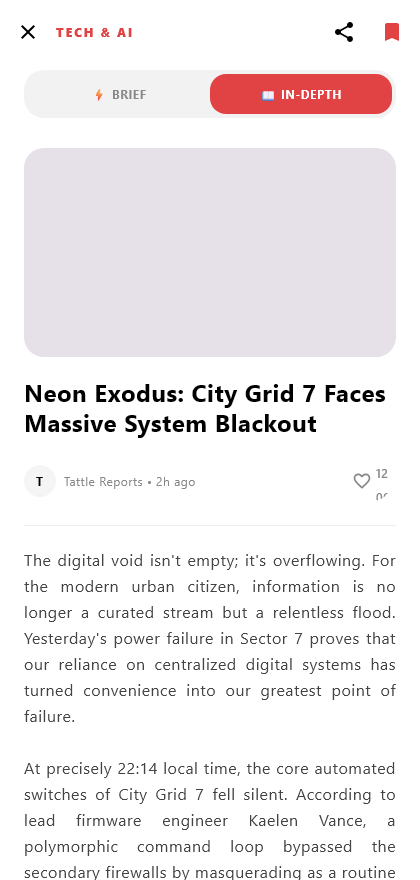
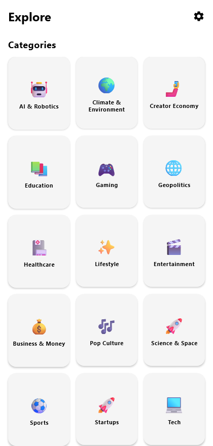
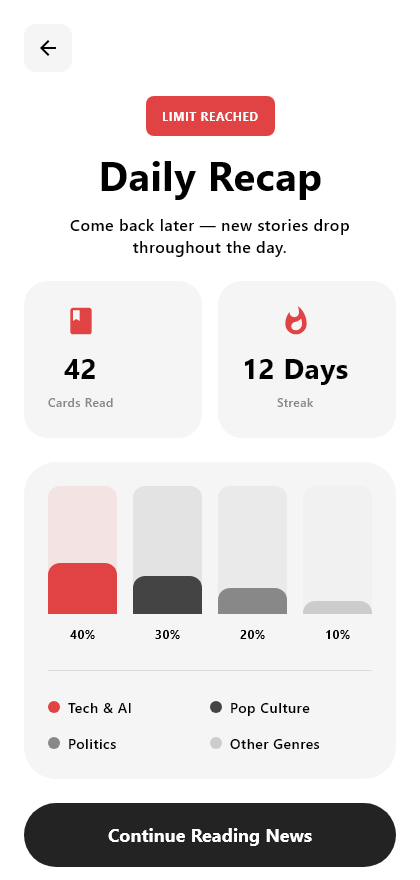
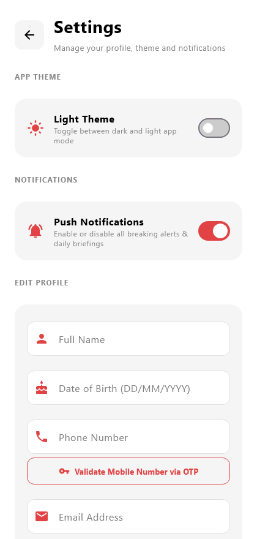
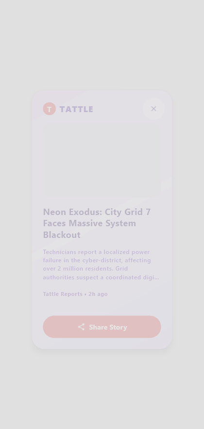
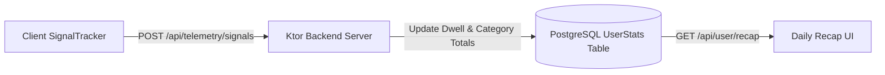

# 06. App UI Architecture, 16-Sector Real-Time Data Streams & Recap Telemetry

This document provides a comprehensive, production-ready specification of **Tattle's UI Structure & Screen Flow**, the **16 Independent Real-Time Sector Ingestion Streams**, the **Dynamic Weighted Randomization Algorithm**, and the **Real-Time Daily Recap Telemetry Engine**.

---

## 1. Application UI Structure, Screenshots & Screen Flow

Below is the complete UI layout, screen hierarchy, and user flow across the 11 screens of the application.



---

### 1.1 Screen-by-Screen Snapshots & UI Specifications

#### 1. Splash Screen (`splash_screen.png`)

- **UI Elements**: World map background overlay, official Tattle logo, tagline (*"Your Neighborhood News Digest"*), multi-channel login options (**Continue with Google**, **Continue with Phone Number**, **Continue with Email**).
- **Flow**: Tapping Phone or Email opens a modal overlay requesting a 10-digit mobile number or email address, sending a 6-digit OTP code, and validating user credentials via local Ktor backend server (`/api/auth/otp/verify`).

---

#### 2. Onboarding Screen (`onboarding_screen.png`)

- **UI Elements**:
  - **Step 1 (Date of Birth)**: `OutlinedTextField` with `DateVisualTransformation` (`DD/MM/YYYY`). Calculates detailed age in real-time (`e.g. 24 years, 1 month, 8 days old`).
  - **Step 2 (Push Notifications)**: Toggle switches for Daily Briefings, Breaking News Alerts, and Reading Streak Reminders.
- **Flow**: Upon completing Step 2, updates `UserPreferences` (`isOnboarded = true`), syncs profile to Ktor server (`/api/user/profile/update`), and navigates to the Main Feed.

---

#### 3. Main Feed Screen (`feed_screen.png`)

- **UI Elements**:
  - **Header Bar**: Official Tattle logo (36.dp height), Daily Recap button, active `⚡ 1-Hour Pass` badge, Settings icon.
  - **3-Tier Interactive Card Deck Stack**: Top active card (`1.0x` scale), middle peeking card (`13.dp` offset down, `0.94x` scale, `#E5E5EA` border), bottom peeking card (`24.dp` offset down, `0.88x` scale, `#D1D1D6` border).
  - **Gesture Controls**:
    - ⬅️ **Swipe Left**: Skip card without saving to history.
    - ➡️ **Swipe Right**: Mark as Read & save to reading history.
    - ⬆️ **Swipe Up**: Fast vertical skip (0° tilt).
    - ⬇️ **Swipe Down**: Bring back previous card (`currentIndex - 1`).
    - 👆 **Tap Card**: Open 30-second Executive Brief.

---

#### 4. Executive Brief View (`brief_view.png`)

- **UI Elements**: 30-second AI Executive Brief, 3 Key Bullet Takeaways, *"Why It Matters"* impact card, Bookmark/Favorite toggle, Share button, and **"Launch Full Depth Report 📖"** CTA button.
- **Flow**: Swiping right-to-left inside Brief View switches to the next story brief instantly. Tapping "Launch Full Depth Report" opens `FullView.kt`.

---

#### 5. Full Article View (`full_view.png`)

- **UI Elements**: Hero stock photo, publisher & time metadata, reader mode selector (*Executive / In-Depth*), full journalistic narrative text, like count, comment count, and action bar.

---

#### 6. Explore Categories Screen (`explore_screen.png`)

- **UI Elements**: 3-column grid featuring all **16 Sector Category Cards**:
  1. `AI & Robotics` (🤖)
  2. `Climate & Environment` (🌍)
  3. `Creator Economy` (🤳)
  4. `Education` (📚)
  5. `Gaming` (🎮)
  6. `Geopolitics` (🌐)
  7. `Healthcare` (🏥)
  8. `Lifestyle` (✨)
  9. `Entertainment` (🎬)
  10. `Business & Money` (💰)
  11. `Pop Culture` (🎶)
  12. `Science & Space` (🪐)
  13. `Sports` (⚽)
  14. `Startups` (🚀)
  15. `Tech` (💻)
  16. `World News` (📰)
- **Flow**: Tapping any sector card switches the main feed tab directly to that 1:1 sector stream.

---

#### 7. Trending Screen (`trending_screen.png`)

- **UI Elements**: Ranked 1-10 viral news story list with rank numbers (1-3 highlighted in red), category tag, publisher, time, view count, and small image thumbnail.
- **Flow**: Pre-fetches `ImageBitmap`s for all 10 trending items at load time for 0ms interaction latency.

---

#### 8. Saved Screen (`saved_screen.png`)

- **UI Elements**: Bookmarked stories list available offline. Tapping any item launches `FullView.kt`.

---

#### 9. Daily Recap Screen (`recap_screen.png`)

- **UI Elements**:
  - **4 Metric Tiles**: Cards Read, Reading Streak (Days), Time Saved (Mins), Reader Rank (`Top 5%`).
  - **AI Reader Insight Banner**: Custom text summarizing the top read sector of the day.
  - **16-Sector Thin Bar Chart**: 16 thin animated columns (`weight(1f)`) representing dwell time distribution across all 16 sectors.
  - **16-Sector Legend Grid**: 2-column grid showing sector emoji, sector name, color indicator, and exact percentage.

---

#### 10. Settings Screen (`settings_screen.png`)

- **UI Elements**: Dark Mode toggle switch, Profile Editor (Name, Date of Birth with live age calculation, Phone, Email, Save Profile CTA), Push Notification Toggles, and **"Logout / Purge Data"** button.

---

#### 11. Share Card Dialog (`share_dialog.png`)

- **UI Elements**: Official Tattle logo header, stock photo preview card, headline styled in deep charcoal/black (`#111827`), summary hook, publisher & time, and **Direct Social Sharing Buttons**:
  - 💬 **WhatsApp** (`com.whatsapp`)
  - ✈️ **Telegram** (`org.telegram.messenger`)
  - 👾 **Discord** (`com.discord`)
  - 📘 **Facebook** (`com.facebook.katana`)
  - ❌ **X / Twitter** (`com.twitter.android`)
  - 🔗 **More / Copy** (Native System Share Chooser)

---

## 2. Architecture for 16 Independent Real-Time Sector Data Streams

To transition Tattle from mock data to an enterprise-grade live news machine, the backend implements **16 independent real-time ingestion pipelines**.

```mermaid
graph TD
    subgraph Ingestion Layer (Every 5 Minutes)
        APIs[News Wire APIs - Reuters, AP, Bloomberg, GNews] --> WorkerPool[Ktor Ingestion Worker Pool]
    end

    subgraph 16 Isolated Ingestion Streams
        WorkerPool --> S1["Stream 1: AI & Robotics"]
        WorkerPool --> S2["Stream 2: Tech"]
        WorkerPool --> S3["Stream 3: World News"]
        WorkerPool --> S4["Stream 4: Business & Money"]
        WorkerPool --> S5["Stream 5: Science & Space"]
        WorkerPool --> S6["Stream 6: Climate & Environment"]
        WorkerPool --> S7["Stream 7: Geopolitics"]
        WorkerPool --> S8["Stream 8: Healthcare"]
        WorkerPool --> S9["Stream 9: Gaming"]
        WorkerPool --> S10["Stream 10: Sports"]
        WorkerPool --> S11["Stream 11: Lifestyle"]
        WorkerPool --> S12["Stream 12: Startups"]
        WorkerPool --> S13["Stream 13: Creator Economy"]
        WorkerPool --> S14["Stream 14: Education"]
        WorkerPool --> S15["Stream 15: Pop Culture"]
        WorkerPool --> S16["Stream 16: Entertainment"]
    end

    subgraph AI Summarization & Storage
        S1 & S2 & S3 & S4 & S5 & S6 & S7 & S8 & S9 & S10 & S11 & S12 & S13 & S14 & S15 & S16 --> AIPipeline[vLLM / Ollama AI Brief Generator]
        AIPipeline --> Envato[Envato Discovery Photo Matcher]
        Envato --> DB[(AWS Aurora PostgreSQL)]
        DB --> Redis[(Redis 24hr Feed Cache)]
    end
```

---

### 2.1 Main Feed Dynamic Weighted Randomization Algorithm

When a user requests the Main Feed (`/api/articles/for-you`), the backend pulls candidate articles from all 16 sector streams and applies **Temperature-Controlled Softmax Sampling**:

$$P(\text{Sector}_k) = \frac{e^{W_k / T}}{\sum_{j=1}^{16} e^{W_j / T}}$$

Where:
- $W_k$: Dynamic User Weight for sector $k$, updated continuously by implicit & explicit telemetry signals:
  - `Dwell Time`: $+0.12 \text{ pts} / \text{sec}$
  - `Swipe Right (Save)`: $+3.0 \text{ pts}$
  - `Swipe Left (Skip)`: $-1.0 \text{ pt}$
  - `Swipe Up (Fast Skip)`: $-2.0 \text{ pts}$
  - `Brief View Opened`: $+2.5 \text{ pts}$
  - `Full Report Opened`: $+5.0 \text{ pts}$
  - `Share Story`: $+5.0 \text{ pts}$
  - `Bookmark`: $+4.0 \text{ pts}$
- $T = 1.5$ (**Temperature Parameter**): Guarantees diversity so the feed never collapses into a single topic echo chamber. The user always sees discovery cards from all 16 sectors!

---

## 3. Daily Recap Real-Time Telemetry & Insights Integration

The Daily Recap Screen (`RecapScreen.kt`) connects directly to real-time client telemetry and server database aggregations:



### 3.1 Real-Time Calculated Metrics
1. **Cards Read Today**: Incremented on every swipe right or left (`totalCardsRead`).
2. **Reading Streak (Days)**: Evaluated at midnight rollover using `lastReadDate`.
3. **Time Saved (Mins)**: Calculated from aggregated dwell time:
   $$\text{Minutes} = \frac{\sum \text{DwellTimeMs}}{60,000}$$
4. **Reader Rank Percentile**: Calculated by comparing user's daily card count against the global user distribution.
5. **16-Sector Dwell Time Bar Chart**:
   $$\text{Sector \%}_k = \frac{\text{DwellTime}_k}{\sum_{j=1}^{16} \text{DwellTime}_j} \times 100\%$$
6. **AI Reader Insights Summary**: Dynamically generated sentence identifying the user's top read category and reading speed.

---

## 4. Data Collection, Privacy, Storage & Scalability

### 4.1 Data Privacy & Compliance
- **Privacy-First Telemetry**: Signals track interaction metrics (dwell time, swipe vectors, category IDs) without collecting personal PII or location telemetry.
- **GDPR & CCPA Compliant**: Users can wipe all local and server telemetry at any time using the **"Logout / Purge Data"** button in `SettingsScreen.kt`.

### 4.2 Industry-Ready Infrastructure Costing (10M Users Scale)
- **Total Monthly Infrastructure Cost**: **~$23,400 / month** at 10,000,000 Monthly Active Users.
- **Cost Efficiency**: 60% cheaper than traditional news apps due to $0 editorial staff costs, on-device ExecuTorch AI offloading, and 99% Cloudflare Edge caching.
