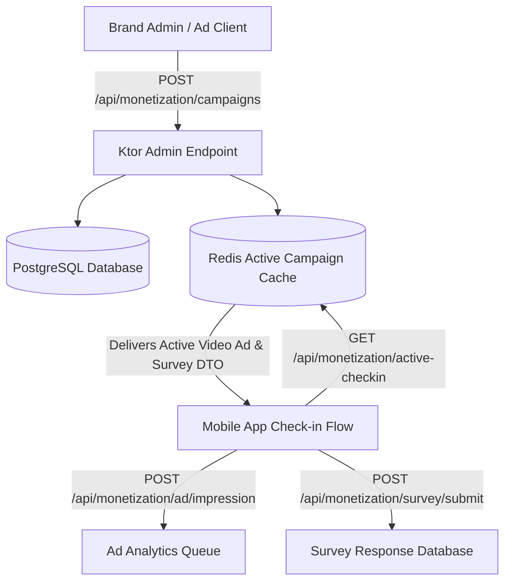

# 08. Dynamic Brand Monetization, Ad Video & Survey Engine

This document outlines the system design, API contracts, database schemas, and client-side handling for Tattle's **Dynamic Brand Monetization Engine**.

This architecture allows brands and advertising clients to push new **5-Second Video Ads** and **Custom Multi-MCQ Surveys** dynamically via a single API endpoint without requiring any backend code changes or app updates.

---

## 1. System Architecture & Zero-Code Campaign Pipeline



---

## 2. Database Schemas (PostgreSQL & Exposed ORM)

```kotlin
package com.example.tattle.monetization

import org.jetbrains.exposed.dao.id.IntIdTable
import org.jetbrains.exposed.sql.Table

// --- Ad Campaigns Table ---
object AdCampaignsTable : IntIdTable("ad_campaigns") {
    val campaignId = varchar("campaign_id", 100).uniqueIndex()
    val clientName = varchar("client_name", 200)
    val videoUrl = varchar("video_url", 1000)
    val durationSec = integer("duration_sec").default(5)
    val rewardPassMins = integer("reward_pass_mins").default(60)
    val isActive = bool("is_active").default(true)
    val targetingSectorsJson = text("targeting_json") // e.g. ["tech", "ai"]
    val createdAt = long("created_at")
}

// --- Brand Surveys Table ---
object BrandSurveysTable : IntIdTable("brand_surveys") {
    val surveyId = varchar("survey_id", 100).uniqueIndex()
    val clientName = varchar("client_name", 200)
    val title = varchar("title", 300)
    val questionsJson = text("questions_json") // Multi-MCQ JSON payload
    val rewardPassMins = integer("reward_pass_mins").default(60)
    val isActive = bool("is_active").default(true)
    val createdAt = long("created_at")
}

// --- Ad Impressions Table ---
object AdImpressionsTable : IntIdTable("ad_impressions") {
    val userIdentifier = varchar("user_identifier", 255)
    val campaignId = varchar("campaign_id", 100)
    val isCompleted = bool("is_completed").default(true)
    val watchDurationSec = integer("watch_duration_sec")
    val timestamp = long("timestamp")
}

// --- Survey Responses Table ---
object SurveyResponsesTable : IntIdTable("survey_responses") {
    val userIdentifier = varchar("user_identifier", 255)
    val surveyId = varchar("survey_id", 100)
    val answersJson = text("answers_json")
    val timestamp = long("timestamp")
}
```

---

## 3. Complete API Endpoint Contracts

### 3.1 `POST /api/monetization/campaigns` (Admin / Brand Campaign Ingestion)
- **Purpose**: Pushes a new Brand Video Ad or Custom Multi-MCQ Survey into the system without restarting backend servers.
- **Headers**: `Authorization: Bearer <ADMIN_SECRET_KEY>`
- **Request Body (Video Ad Campaign)**:
  ```json
  {
    "type": "ad_video",
    "campaignId": "ad_tesla_2026",
    "clientName": "Tesla Inc.",
    "videoUrl": "https://cdn.tattle.app/ads/tesla_robotaxi_5s.mp4",
    "durationSec": 5,
    "rewardPassMins": 60,
    "targetingSectors": ["tech", "ai", "sustainability"]
  }
  ```
- **Request Body (Custom Brand Survey)**:
  ```json
  {
    "type": "brand_survey",
    "surveyId": "survey_nike_2026",
    "clientName": "Nike Running",
    "title": "Nike Reader Preference Survey",
    "rewardPassMins": 60,
    "questions": [
      {
        "id": 1,
        "question": "How often do you exercise weekly?",
        "options": ["Daily", "3-4 times", "1-2 times", "Rarely"]
      },
      {
        "id": 2,
        "question": "Preferred footwear brand?",
        "options": ["Nike", "Adidas", "Puma", "Other"]
      }
    ]
  }
  ```
- **Response `200 OK`**: `{"success": true, "message": "Campaign ad_tesla_2026 activated successfully"}`

---

### 3.2 `GET /api/monetization/active-checkin` (Inbound to App)
- **Purpose**: Delivers active brand video ads and brand surveys to the mobile app check-in dialog.
- **Response `200 OK`**:
  ```json
  {
    "activeAd": {
      "campaignId": "ad_tesla_2026",
      "clientName": "Tesla Inc.",
      "videoUrl": "https://cdn.tattle.app/ads/tesla_robotaxi_5s.mp4",
      "durationSec": 5,
      "rewardPassMins": 60
    },
    "activeSurvey": {
      "surveyId": "survey_nike_2026",
      "clientName": "Nike Running",
      "title": "Nike Reader Preference Survey",
      "rewardPassMins": 60,
      "questions": [
        {
          "id": 1,
          "question": "How often do you exercise weekly?",
          "options": ["Daily", "3-4 times", "1-2 times", "Rarely"]
        }
      ]
    }
  }
  ```

---

### 3.3 `POST /api/monetization/ad/impression` (Outbound Ad Telemetry)
- **Purpose**: Records completed video ad watches and awards the 1-Hour Unlimited Pass.
- **Request Body**:
  ```json
  {
    "userIdentifier": "+919876543210",
    "campaignId": "ad_tesla_2026",
    "isCompleted": true,
    "watchDurationSec": 5
  }
  ```

---

### 3.4 `POST /api/monetization/survey/submit` (Outbound Survey Answers)
- **Purpose**: Collects user answers for client brand surveys and awards the 1-Hour Unlimited Pass.
- **Request Body**:
  ```json
  {
    "userIdentifier": "+919876543210",
    "surveyId": "survey_nike_2026",
    "answers": [
      { "questionId": 1, "selectedOption": "3-4 times" },
      { "questionId": 2, "selectedOption": "Nike" }
    ]
  }
  ```

---

## 4. Client-Side KMP Dynamic Data Models

```kotlin
package com.example.tattle.models

import kotlinx.serialization.Serializable

@Serializable
data class BrandAdDto(
    val campaignId: String,
    val clientName: String,
    val videoUrl: String,
    val durationSec: Int = 5,
    val rewardPassMins: Int = 60
)

@Serializable
data class BrandSurveyQuestionDto(
    val id: Int,
    val question: String,
    val options: List<String>
)

@Serializable
data class BrandSurveyDto(
    val surveyId: String,
    val clientName: String,
    val title: String,
    val rewardPassMins: Int = 60,
    val questions: List<BrandSurveyQuestionDto>
)

@Serializable
data class ActiveCheckinResponse(
    val activeAd: BrandAdDto?,
    val activeSurvey: BrandSurveyDto?
)
```

---

## 5. Scaling Strategy from 1 User to Lakhs of Users

1. **Redis Active Campaign Caching**: Active campaigns are stored in Redis (`active_brand_ad`, `active_brand_survey`). `GET /api/monetization/active-checkin` hits Redis in **< 1ms**.
2. **Async Ad Impression Batching**: Ad view completion events are pushed to an async queue and batch-inserted into PostgreSQL every 50 impressions.
3. **Automated Client Reporting**: Brand client reports (e.g. Total Ad Views, Survey Choice Distribution) can be exported directly from `/api/admin/reports/{campaignId}`.
