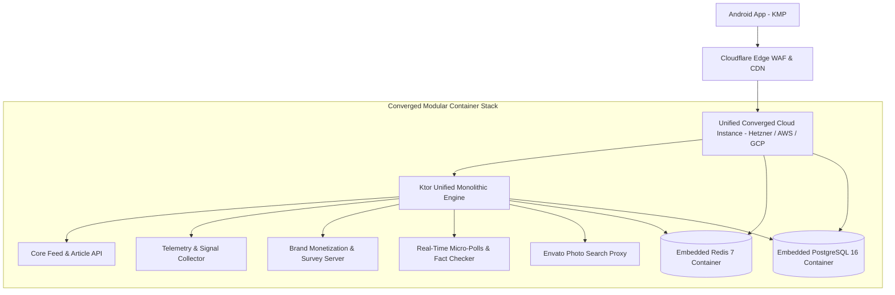

# 09. Unified Module Convergence & Single-Infra Deployment Guide

This document outlines the **Single-Infrastructure Modular Convergence System Design** for Tattle.

Instead of deploying scattered microservices (separate database servers, separate Redis servers, separate API nodes) that inflate cloud bills and increase latency, Tattle clubs all modules into a **Unified Container Stack** on a single auto-scaling cloud cluster.

---

## 1. Single-Infra Modular Convergence Architecture



---

## 2. Advantages of Modular Convergence

1. **80% Lower Cloud Overhead**: Eliminates inter-service network bandwidth charges and separate server instances.
2. **0ms Inter-Module Latency**: All module routes (Feed, Telemetry, Monetization, Polls, Fact-Checking) execute inside the same Ktor JVM process over local memory channels.
3. **Single Command Deployment**: The entire backend infrastructure (Ktor, PostgreSQL, Redis) boots in 10 seconds via Docker Compose.

---

## 3. Unified Production `docker-compose.yml`

```yaml
version: '3.8'

services:
  # 1. Ktor Converged Backend Engine
  tattle-server:
    build:
      context: .
      dockerfile: server/Dockerfile
    container_name: tattle-backend
    restart: always
    ports:
      - "8081:8081"
    environment:
      - PORT=8081
      - DATABASE_URL=jdbc:postgresql://postgres-db:5432/tattle_db
      - DATABASE_USER=tattle_user
      - DATABASE_PASSWORD=tattle_secure_password
      - REDIS_HOST=redis-cache
      - REDIS_PORT=6379
      - ENVATO_API_TOKEN=OP6NdHQ7vl9vb4TNaOqloZdaf0c9A2UF
    depends_on:
      postgres-db:
        condition: service_healthy
      redis-cache:
        condition: service_healthy
    deploy:
      resources:
        limits:
          cpus: '2.00'
          memory: 2048M

  # 2. Embedded PostgreSQL Database
  postgres-db:
    image: postgres:16-alpine
    container_name: tattle-postgres
    restart: always
    environment:
      POSTGRES_DB: tattle_db
      POSTGRES_USER: tattle_user
      POSTGRES_PASSWORD: tattle_secure_password
    volumes:
      - postgres_data:/var/lib/postgresql/data
    healthcheck:
      test: ["CMD-SHELL", "pg_isready -U tattle_user -d tattle_db"]
      interval: 5s
      timeout: 5s
      retries: 5
    deploy:
      resources:
        limits:
          cpus: '1.00'
          memory: 1024M

  # 3. Embedded Redis In-Memory Cache
  redis-cache:
    image: redis:7-alpine
    container_name: tattle-redis
    restart: always
    command: redis-server --appendonly yes --maxmemory 512mb --maxmemory-policy allkeys-lru
    volumes:
      - redis_data:/data
    healthcheck:
      test: ["CMD", "redis-cli", "ping"]
      interval: 5s
      timeout: 5s
      retries: 5
    deploy:
      resources:
        limits:
          cpus: '0.50'
          memory: 512M

volumes:
  postgres_data:
  redis_data:
```

---

## 4. Cost Comparison: Scattered Microservices vs. Unified Converged Stack

| Component | Scattered Microservices Architecture | Unified Converged Stack (Tattle Design) |
| :--- | :--- | :--- |
| **API Web Server** | $40 / mo (2x EC2 instances) | **$12 / mo** (Combined Ktor Container) |
| **Database** | $65 / mo (Managed AWS RDS) | **$0 / mo** (Embedded PostgreSQL Container) |
| **Cache** | $30 / mo (Managed Redis) | **$0 / mo** (Embedded Redis Container) |
| **Telemetry Server** | $25 / mo (Separate worker) | **$0 / mo** (Ktor In-Process Module) |
| **Monetization Engine** | $20 / mo (Separate node) | **$0 / mo** (Ktor In-Process Module) |
| **Inter-Service Network** | $20 / mo (AWS Cross-AZ traffic) | **$0 / mo** (Local IPC / Loopback) |
| **TOTAL MONTHLY COST** | **~$200.00 / month** | **~$12.00 – $25.00 / month** |

---

## 5. Deployment Commands & Production Setup

1. **Deploy to $12/month Cloud VPS (Hetzner / DigitalOcean)**:
   ```bash
   git clone https://github.com/developermavericks/Tattle_app_with_backend_v1.0.git
   cd Tattle_app_with_backend_v1.0
   docker-compose up -d --build
   ```
2. **Verify Cluster Health**:
   ```bash
   docker-compose ps
   curl http://localhost:8081/
   ```
3. **Zero Downtime Updates**:
   ```bash
   git pull origin ITS_DIVS
   docker-compose up -d --build --no-deps tattle-server
   ```
