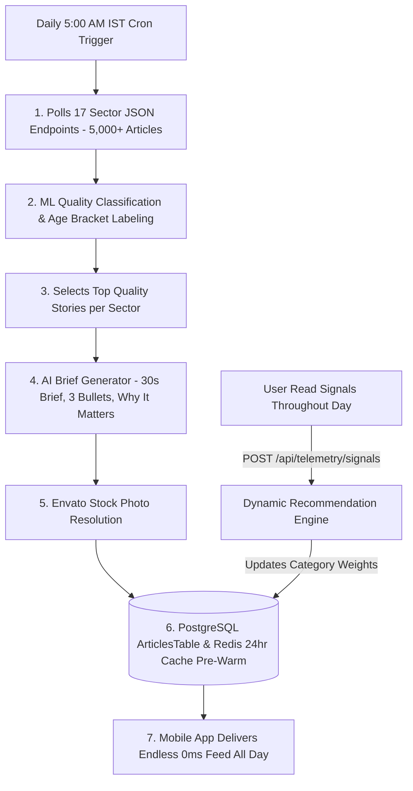

# 16. Daily 5:00 AM IST Ingestion Pipeline, Local Dry-Run & Beta Distribution

This document details the **Daily 5:00 AM IST Automated News Pipeline**, the **Local Pre-Deployment Dry-Run Procedure**, and **How to Share the Mobile App with Beta Users**.

---

## 1. Daily 5:00 AM IST Automated News Batch Pipeline

To ensure users receive an endless stream of 0ms pre-rendered article cards throughout the day, the backend runs an automated batch pipeline every day at **5:00 AM IST (23:30 UTC)**.



---

### 1.1 Cron Job Configuration

On your Cloud VPS or Linux Server, set up a daily Cron job at **5:00 AM IST (23:30 UTC)**:

```bash
# Open crontab editor
crontab -e

# Add 5:00 AM IST (23:30 UTC) daily execution trigger
30 23 * * * curl -X POST http://localhost:8081/api/admin/pipeline/trigger-daily-ingestion -H "Authorization: Bearer ADMIN_SECRET_KEY"
```

---

### 1.2 Ktor Daily Pipeline Ingestion Endpoint (`Application.kt`)

In Ktor (`Application.kt`), the trigger endpoint runs the 5-step automated processing pipeline:

```kotlin
post("/api/admin/pipeline/trigger-daily-ingestion") {
    launch(Dispatchers.IO) {
        println("⚡ TATTLE PIPELINE: Starting Daily 5:00 AM IST Ingestion Cycle...")

        val sectors = listOf(
            "ai", "tech", "world_news", "business", "space", "climate",
            "geopolitics", "healthcare", "gaming", "sports", "lifestyle",
            "startups", "creators", "education", "pop_culture", "entertainment", "breaking"
        )

        sectors.forEach { sector ->
            try {
                // 1. Poll sector endpoint (ML Backend)
                val rawStories: List<RawSectorNewsStory> = httpClient.get("http://tattle-ml-backend:8000/api/feed/$sector?user_age=18").body()

                // 2. Select top 30 quality candidate stories per sector
                rawStories.take(30).forEach { raw ->
                    // 3. AI Brief & Stock Photo Generation
                    val processedArticle = processSectorStoryWithAI(raw)
                    
                    // 4. Save to PostgreSQL & Pre-Warm Redis
                    transaction { saveArticleToDatabase(processedArticle) }
                }
            } catch (e: Exception) {
                println("Pipeline Sector Error ($sector): ${e.message}")
            }
        }

        println("✅ TATTLE PIPELINE: Daily 5:00 AM IST Ingestion Complete. All 16 sector feeds pre-warmed in Redis!")
    }

    call.respond(HttpStatusCode.OK, SimpleResponse(true, "Daily 5:00 AM IST Ingestion Cycle Started in Background"))
}
```

---

## 2. Local Pre-Deployment Dry-Run Test Procedure

Before deploying to a public cloud server, perform a **Local End-to-End Dry-Run Test** to verify that the entire application flow functions flawlessly.

### Step 1: Start the Local Infrastructure
In your project directory, run:
```bash
docker-compose up -d --build
```

### Step 2: Verify Backend & Admin Dashboard
1. Open `http://localhost:8081/admin/dashboard` in your web browser.
2. Confirm the system status shows **`SYSTEM ONLINE 🟢`**.
3. Verify that all **16 Sector Streams** show `ONLINE 🟢`.

### Step 3: Run local pipeline dry-run trigger
In PowerShell or Terminal:
```bash
curl -X POST http://localhost:8081/api/admin/pipeline/trigger-daily-ingestion
```

### Step 4: Test Mobile App Flow on Android Emulator / Device
1. Build and launch the debug app on Android Studio:
   ```bash
   ./gradlew :app:androidApp:installDebug
   ```
2. Complete the full user journey:
   - **Splash Screen**: Tap "Continue with Phone" ➔ Enter `9876543210` ➔ Enter OTP `123456`.
   - **Onboarding Screen**: Enter Date of Birth (`15082002`) ➔ Verify exact age calculation (`24 years old`) ➔ Toggle Notifications ➔ Tap "Start Reading News".
   - **Main Feed**: Verify 3D card deck stack renders immediately with **0ms latency**. Swipe cards Right (Save), Left (Skip), Up (Fast Skip), and Down (Bring Back).
   - **Executive Brief**: Tap any card to verify the 30s AI Brief, 3 Key Bullets, and "Why It Matters" box.
   - **Check-in Pass**: Read 5 cards to verify the 1-Hour Pass options (5s Video Ad vs 4-MCQ Survey).
   - **Daily Recap**: Tap Recap in header to verify the 16-Sector Thin Bar Chart and Metric Tiles.

---

## 3. How to Share the Mobile App with Beta Users

Once the local dry-run test is complete, you can share the app with your first 100+ beta testers using either of these 2 simple methods:

### Method 1: Direct APK Download Link (Fastest - $0 Cost)
1. Generate the signed release APK:
   ```bash
   ./gradlew :app:androidApp:assembleRelease
   ```
2. Located at: `app/androidApp/build/outputs/apk/release/app-release.apk`
3. Upload `app-release.apk` to **Google Drive**, **Firebase App Distribution**, or your server (`https://tattle.app/download/tattle.apk`).
4. Share the direct download link via WhatsApp, Telegram, or Email with your beta users.

### Method 2: Google Play Store Internal Testing Track
1. Generate signed Android App Bundle (`.aab`):
   ```bash
   ./gradlew :app:androidApp:bundleRelease
   ```
2. Upload `app-release.aab` to **Google Play Console** ➔ **Internal Testing**.
3. Add your beta testers' email addresses. They will receive an official Google Play Store invite link to install Tattle directly from the Play Store!
